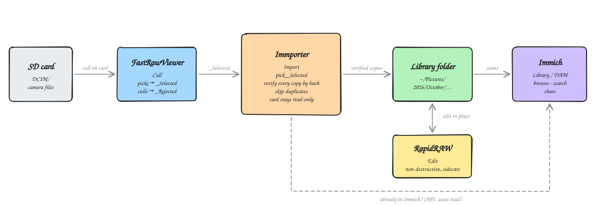

# Immporter

**Import photos and videos from camera cards, verified, with Immich duplicate checking.**



**Where it fits:**
- **[FastRawViewer](https://www.fastrawviewer.com):** cull on the card. Picks go to `_Selected`, rejects to `_Rejected`.
- **Immporter:** copies the picks into a dated library folder. Every copy is verified, and anything already in the library or in Immich is skipped.
- **[RapidRAW](https://github.com/CyberTimon/RapidRAW):** non-destructive editing in place, in the library folder.
- **[Immich](https://immich.app):** scans the library folder as an external library, for browsing, search and sharing.

<sub>The diagram's source is [docs/workflow.excalidraw](docs/workflow.excalidraw). Open it at [excalidraw.com](https://excalidraw.com), then export over `docs/workflow.svg`.</sub>

A fast, verified photo importer for camera cards, modelled on Lightroom's Import dialog. Insert a card and you see every photo on it within seconds, with anything already in your library greyed out. Press **Import** to copy the new ones into a dated folder structure; each copy is checked against the original before it counts as done.

It is built with [Tauri 2](https://tauri.app), Rust and React. Its look follows [RapidRAW](https://github.com/CyberTimon/RapidRAW), so the two apps feel related. macOS is the primary platform today; Windows and Linux are planned (see [Platform status](#platform-status)).

## Features

- **Instant grid.** Card contents appear as soon as the file list is read. Previews and capture dates fill in after that, starting with the photos on screen.
- **Embedded previews.** Thumbnails come from the JPEG every camera embeds inside its RAW files, so no RAW decoding is needed. Usually only the first few MB of each file are read.
- **Works with most cameras:**
  - RAW: ORF, ORI, ARW, SR2, CR2, CR3, CRW, NEF, NRW, RAF, RW2, DNG, PEF, SRW, 3FR, IIQ, ERF, MEF, MOS, MRW, X3F, KDC, DCR;
  - also JPEG, HEIC/HEIF, TIFF and PNG;
  - **videos**: MOV, MP4, M4V, MTS/M2TS and AVI, including Sony's `PRIVATE/M4ROOT/CLIP` and AVCHD folders outside DCIM.
- **RAW+JPEG pairs** (and ORF+ORI) show as one tile and are imported together. A video is always its own tile; a Canon `.THM` thumbnail beside it is imported with it.
- **Video tiles** show a frame from the clip, its length and resolution (e.g. `▶ MOV · 0:32 · 4K`). The frame is decoded by the app itself from the first few MB of the clip, so no extra software is needed.
- **Duplicates are detected, not guessed.** The app checks your destination library *and* its own import history, and only marks a file as a duplicate after comparing content hashes.
- **Verified copies.** Every file is hashed while it is copied, read back from disk and hashed again before it is moved into place.
- **The card is never written to.**
- **Templates** for folder structure (default `2026/October`) and file names.
- **Immich integration (optional).** Photos already in your [Immich](https://immich.app) library are flagged as duplicates, including Immich *external libraries*.

## Using it

1. **Pick a source** in the left pane:
   - **Click a card** (cards with a `DCIM` folder are listed first) to import everything under its `DCIM` folder.
   - **Click the ▸ arrow** to browse the card's folders, then click a folder to import just that folder. Each folder shows how many photos it holds directly.
   - **Choose folder…** imports from any folder on your computer instead.
   - **Include subfolders** (off by default) also scans the folders inside a picked folder. Picking a whole card always includes everything.
   - **Skip _Rejected folders** (on by default) leaves out folders named `_Rejected`. Picking `_Rejected` itself still shows its photos.
   - **Include videos** (on by default) shows and imports video clips.

   **Culling with FastRawViewer first?** It moves your picks into `_Selected` and your culls into `_Rejected` on the card. Expand the card down to `DCIM › 100OMSYS › _Selected` and click it to import only your picks. A breadcrumb above the grid shows which folder you're looking at.
2. **Pick a destination** in the right pane: choose your photo library root (e.g. `~/Pictures`). The app indexes it in the background. The status line shows how many photos it knows about, and **Rebuild** forces a full re-scan and re-hash.
3. **Review the grid.**
   - New photos are pre-selected.
   - Click a tile to toggle it, and Shift-click to select a range.
   - ⌘A / ⌘D (Ctrl on Windows/Linux) select all or none.
   - The filter at the top switches between All, New and Duplicates. **Hide duplicates** (the eye button) removes photos already in your library from the All view. The slider changes the tile size.
   - **Sort** by Capture time (the default), File name or Folder; ↑/↓ reverses the order. Until a photo's EXIF date has been read, its file time stands in, so the order rarely shifts.
4. **Set the folder structure and file naming** (see [Templates](#templates)). The **Example** box shows exactly where the first selected photo will go.
5. Press **Import**. A progress dialog shows speed and time remaining. When it finishes, you get a summary with **Retry failed** and **Show in folder**.

### Tile badges

| Badge | Meaning |
| --- | --- |
| **In library** | An identical file (same hash) is already in the destination. It is never imported again. |
| **Imported** | This app imported the file before, and that copy still exists, e.g. in a previous library folder. It is skipped unless **Import duplicates** is on. |
| **Deleted** | This app imported the file before, but that copy is gone and the photo isn't in your library or Immich, so you probably deleted it on purpose. It is skipped unless **Import previously deleted** is on. |
| **Checking** | Name, size and EXIF match a library file; the hash comparison is running. |
| **☁** (next to another badge) | Also in your Immich library. Shown for photos already in the destination or import history, e.g. after copying your library to a NAS that Immich indexes. |
| **In Immich** | Found in your Immich library (☁ matched by name, size and capture time; ✓ matched by file contents). Skipped unless **Import duplicates** is on. Double-click opens the photo in Immich. |
| **Checking Immich** | New locally; waiting for Immich's answer. |
| ⚠ next to the date | The file has no EXIF capture date; the file's creation or modification time is used instead. |
| ✓ / ! | Result of the last import: verified copy, or failed (hover the tile for the reason). |

### Options

- **Import duplicates.** Lets you import photos found in Immich, or imported before to a folder that still has them. Files already in the destination are never copied twice regardless.
- **Import previously deleted** (off by default). Photos this app imported before whose copy has since disappeared, and that aren't in your library or Immich, are assumed deleted on purpose and are skipped. Turn this on to bring them back.
- **Paranoid verification** (on by default). Reads every source file a second time and compares, to catch intermittent card-reader errors. It costs one extra read of each file, which roughly doubles the import time of large videos.

Settings are remembered between launches:
- destination and recent destinations;
- folder and naming templates;
- the Import duplicates, Import previously deleted, Paranoid verification, Hide duplicates, Include subfolders, Include videos and Skip _Rejected toggles;
- sort order and thumbnail size;
- Immich settings (the API key stays in the keychain).

## Templates

Folder and file-name templates combine plain text with these tokens:

| Token | Example | Token | Example |
| --- | --- | --- | --- |
| `{YYYY}` | 2026 | `{HH}` | 07 |
| `{YY}` | 26 | `{mm}` | 08 |
| `{MMMM}` | October | `{ss}` | 09 |
| `{MMM}` | Oct | `{camera}` | OM-1 Mark II |
| `{MM}` | 10 | `{make}` | OM Digital Solutions |
| `{M}` | 10 | `{original}` | P8200112 (original name, no extension) |
| `{DD}` / `{D}` | 05 / 5 | `{seq}` | 0001 (counts up in shooting order within an import) |

The **folder template** uses `/` to make sub-folders, e.g. `{YYYY}/{YYYY}-{MM}-{DD}`. Leave it empty to put everything directly in the destination.

The **file name template** sets the name without the extension; the original extension is kept. Both files of a RAW+JPEG pair get the same name.

Dates come from EXIF *DateTimeOriginal*. If a file has none, its creation time is used, then its modification time. Characters that are invalid on any OS are replaced with `-`.

If the target name is already taken by a *different* file (for example, an edited JPEG in your library), the new copy gets a `_1`, `_2`, … suffix. Existing files are never overwritten.

## How duplicate detection works

Every photo on the card goes through up to three stages, each more expensive than the last, so most files are settled cheaply:

1. **Name + size.** The file is looked up in the destination index and in the import history. It also matches if a file of the same size sits at the exact path the photo would be imported to.
2. **EXIF.** Candidates must have the same capture time and, where both sides record them, the same camera serial number and image number.
3. **Hash.** The card file and the library file are both hashed with BLAKE3. Only identical hashes make a duplicate. Library hashes are cached, keyed by size and modification time, so later checks are instant.

**RAW+JPEG pairs are judged by the RAW.** If the RAW is already in your library, the whole pair is a duplicate, even when the library's JPEG differs. Lightroom and Camera Raw, for example, write edit metadata into JPEG files. The tile's tooltip names any such file. The importer never overwrites anything in your library.

Because the destination folder itself is checked, photos copied there by Lightroom, Finder or any other tool are recognised too. Verified matches are remembered so the next scan of the same card is faster.

## Immich

The importer can ask an [Immich](https://immich.app) server (v3.2 or newer) whether a photo is already in your library. Click the **gear** at the top of the right pane to set it up:

1. In Immich, open **Account Settings → API Keys** and create a key with only the **`asset.read`** permission. The importer only searches your library; it never uploads, edits or deletes anything.
2. Enter the server URL (e.g. `https://photos.example.com`) and paste the key. Press **Test connection** to check the server version and the key's permission.
3. Save. The key is stored in the operating system's keychain (macOS Keychain, Windows Credential Manager or the Linux Secret Service), never in the app's database. The status line under **Duplicates** shows whether Immich is reachable.

### How photos are matched

Every photo is looked up in Immich, in batches of up to 200 file names per request. For photos the local checks found to be new, a match makes them **In Immich**. Photos already in your destination folder or import history keep that status and get a ☁ marker if Immich has them too.

A photo matches when an Immich asset has:
- the same file name: the card's name, or the name the file-naming template would give it;
- the same exact size in bytes;
- the same EXIF capture time.

Assets that were *uploaded* to Immich carry a content checksum, so for those the card file's SHA-1 must also match. Assets in an Immich **external library** don't have a content checksum: Immich hashes their path instead. For those, name, size and capture time decide.

**Also match the folder path** (optional) additionally requires Immich's file path to agree with the folder structure the importer would use, e.g. `2026/October/IMG_2599.JPG`. If Immich sees your library under a different root (say `/mnt/photos`), enter that as the **path prefix**. After a successful connection test, the dialog suggests one.

If Immich can't be reached, photos fall back to **New** and the status line shows the error. Imports are never blocked by Immich.

### Renamed files

Immich lookups are by **file name**. For external libraries Immich has no content hash, so a file can only be found under a name the importer knows. Three sources of names are tried:

1. the card's original name, e.g. `P3270048.ORF`;
2. the name your **current** file-naming template would give it, e.g. `20260327_070531.ORF`;
3. every name the file was **actually imported under** before, from the app's import history. This covers files imported with an older template, `{seq}` numbers and `_1` collision suffixes.

So a file renamed on import is still found in Immich after you change the naming template. With **Also match the folder path** on, a name from the import history is checked against the folder that copy actually went to.

> **A renamed file can't be found in Immich when:**
> - **it was renamed outside Immporter** (by another app, or by hand in Finder or Explorer), because the importer has no record of the new name; or
> - **the Immporter import history has been wiped** (the app's `catalog.sqlite` deleted, or the app reinstalled with its data removed) **and** the current naming template no longer produces that name.
>
> In those cases the photo shows as **New** even though it's in Immich, and importing it creates a second copy. The destination-folder check below has the same limitation, so leave **New** photos you know you already have unselected.

The destination-folder check is more forgiving. It confirms every match by content hash, and it finds renamed copies in two ways: through the import history (which records each card file's original name and where its copy went) or at the path the current templates produce. It only misses a renamed copy if the import history has been cleared **and** the templates have changed, or if the file was renamed outside this app.

## Safety

**The card is read-only.**
- Source files are only ever opened read-only, through a single module ([readonly.rs](src-tauri/src/readonly.rs)). A unit test fails the build if any other module uses a file-writing API.
- Thumbnails, the catalog and the import journal live in the app's own data folders.
- The app refuses to import onto the source volume.

**Every copy is verified.** For each file:
1. The file is streamed from the card into a hidden `.<name>.importing` file in the destination folder, and hashed as it is read.
2. The copy is flushed to disk (`fsync`), then read back with the OS cache bypassed where possible, and hashed again.
3. With paranoid verification, the card file is read and hashed a second time.
4. Only if all hashes match is the file renamed to its final name. The rename refuses to replace an existing file.
5. On any mismatch or I/O error the temp file is deleted and the copy retried, up to 3 attempts. After that the file is reported as failed and nothing is left behind.

**Crash-safe.**
- Each file's progress is journaled in SQLite.
- If the app quits or the power fails mid-import, leftover temp files are removed on the next launch.
- Re-scanning the card shows what still needs importing.

## Rules and design decisions

These are the behaviours the importer guarantees, and why. Change them deliberately, not by accident.

### Never lose or alter anything

| Rule | Why |
| --- | --- |
| The source card is strictly read-only; a unit test fails the build if a module other than the importer and thumbnail cache uses a file-writing API. | Cards are often the only copy of a shoot. |
| Nothing in the library is ever overwritten. A name clash with a different file gives the new copy a `_1`, `_2`, … suffix. | Your library copies may hold edits, e.g. from Lightroom, Camera Raw or DxO. |
| A copy only counts once its hash matches the source, after being written, flushed and read back from disk. Paranoid verification (on by default) also reads the card twice. | Card readers and cables fail silently; a corrupt copy is worse than none. |
| Failures are retried up to 3 times, then reported. Nothing half-written is left behind, and imports are journaled so a crash is cleaned up on the next launch. | You must always know exactly what made it. |
| Immich is only searched, never changed, and the API key needs nothing beyond `asset.read`. | The importer has no business modifying your library server. |

### What counts as a duplicate

| Rule | Why |
| --- | --- |
| Only a **content hash match** marks a file as already in the destination folder. Name, size and EXIF just pick out the candidates. | Camera file numbers repeat (`P1010001` after a reset), so names alone are unreliable. |
| Photos already in the destination folder are **never** imported again, even with **Import duplicates** on. | A second identical copy has no value. |
| When a photo matches in more than one place, the badge shows the most useful one: **In library**, then **In Immich**, then **Imported**, then **Deleted**. | A photo imported before but since deleted from the library, while still in Immich, shows **In Immich**. That tells you where it actually lives. |
| Photos found only in Immich, or imported before to a folder that still has them, are skipped by default, and **Import duplicates** lets you import them anyway. | You may deliberately want a fresh local copy. |
| Photos imported before whose copy is gone, and that aren't in the library or Immich, are treated as **deleted on purpose** and skipped. **Import previously deleted** brings them back. | Deleting a photo is a decision; re-inserting the card shouldn't undo it silently. |
| **RAW+JPEG pairs are judged by the RAW.** If the RAW is in the library, the pair is a duplicate even when the library's JPEG differs. The pair also waits for its RAW's check before it can be selected. | Lightroom and Camera Raw write edit metadata *into* JPEG files, so the library JPEG no longer matches the card. Re-importing it would only add an unedited duplicate. |
| Every photo is looked up in Immich. For a photo that's new locally, Immich decides whether it's a duplicate. For a photo already in the library, Immich only adds a ☁ marker. | You can see at a glance what Immich also has. Lookups are batched and need no card reads, so this costs only a few requests per card. |
| If Immich is unreachable, photos fall back to **New**; Immich never blocks an import. | A server outage shouldn't stop you emptying a card. |

### Immich matching

| Rule | Why |
| --- | --- |
| Photos are looked up by **file name**: the card name, the name the current template would produce, and any name the import history recorded. Lookups are batched, up to 200 names per request. | It's fast and needs no card reads, and renamed imports are found even after a template change. It fails only for files renamed outside the app or after the import history is wiped; see [Renamed files](#renamed-files). |
| **External-library** assets match on exact byte size plus EXIF capture time. | Immich doesn't content-hash external-library files: their checksum is a hash of the *path*. |
| **Videos** match on file name and exact size only. | Cameras disagree on whether video timestamps are UTC or local, so the times can differ by hours even for the same clip. An exact size match on a large video is strong evidence. |
| **Uploaded** assets must also match the card file's SHA-1. | They carry a real content checksum, so it is used. |
| **Also match the folder path** (optional, with a path prefix) additionally requires Immich's path to match the importer's folder structure. | It's a stricter check for libraries that follow the same layout. |
| The API key lives in the OS keychain, never in the app database or the UI. | It is a credential. |

### Choosing what to import

| Rule | Why |
| --- | --- |
| Clicking a card scans everything under `DCIM`; picking a folder scans only that folder unless **Include subfolders** is on. | You pick a folder to narrow the import, e.g. to FastRawViewer's `_Selected`. |
| `_Rejected` folders are skipped by default, unless you pick one directly. | They hold photos you already decided not to keep. |
| The "never import onto the source" check covers the **whole card**, even when only a folder of it was picked. | Picking `_Selected` must not allow writing into another folder of the same card. |
| Opening a card or folder resets the grid to the **All** tab. | Otherwise new photos look "missing" while the Duplicates tab is still selected. |
| The grid is in capture order by default, using the file time until the EXIF date is known. | Bursts and picks from different folders read in shooting order. |

### Videos

| Rule | Why |
| --- | --- |
| Videos use the same folder and naming templates as photos. | Clips stay next to the photos from the same day. |
| Video frames are decoded by the app's own web view from a read-only stream of the clip; only files of the current scan can be streamed. | No ffmpeg to install or bundle, and the card is still never written to. |
| Videos never pair with a photo of the same name. | Some cameras reuse numbers across stills and clips. |

### Dates and naming

| Rule | Why |
| --- | --- |
| The date comes from EXIF *DateTimeOriginal*, then the file's creation time, then its modification time; a ⚠ marks a tile that used a fallback. | File times on cards are often wrong; EXIF reflects when the photo was taken. |
| Import is disabled until the selected photos have finished their checks. | Otherwise a photo could be filed by a fallback date before its EXIF was read. |
| Templates only produce names that are safe on every OS, and can't escape the destination (`..` is dropped). | The app targets macOS, Windows and Linux. |

### Distribution

| Rule | Why |
| --- | --- |
| No personal names appear in code, identifiers or metadata. The app identifier is `app.sdcardimporter`. | The app may be shared with other people. |
| Release builds catch panics instead of aborting. | A malformed RAW file should be skipped, not crash the app. |

## Building

Requirements:
- [Rust](https://rustup.rs) (stable);
- Node.js 20+;
- the [Tauri prerequisites](https://tauri.app/start/prerequisites/) for your OS (on macOS, the Xcode command-line tools).

```sh
npm install
npm run tauri dev      # run in development
npm run tauri build    # build a release app/installer into src-tauri/target/release/bundle
```

App data lives at:

| | Catalog (SQLite) | Thumbnail cache |
| --- | --- | --- |
| macOS | `~/Library/Application Support/app.sdcardimporter/` | `~/Library/Caches/app.sdcardimporter/thumbs/` |
| Linux | `~/.local/share/app.sdcardimporter/` | `~/.cache/app.sdcardimporter/thumbs/` |
| Windows | `%APPDATA%\app.sdcardimporter\` | `%LOCALAPPDATA%\app.sdcardimporter\thumbs\` |

Deleting the thumbnail cache is always safe. Deleting the catalog forgets the import history, but the destination index is rebuilt automatically, so files already in your library are still recognised.

## Testing

```sh
cd src-tauri
cargo test --release
```

The unit tests cover:
- templates, pairing and the duplicate stages;
- the import pipeline: corrupted writes are retried and then failed, suffixes are added, a read-only source stays untouched;
- crash recovery.

An end-to-end test copies real photos to a temporary "card", scans, imports, verifies byte-for-byte, then rescans with an empty catalog to confirm everything is recognised as already in the library:

```sh
SAMPLE_DIR=~/Pictures/2026/August cargo test --release --test end_to_end -- --ignored --nocapture
```

In debug builds, `SDI_AUTOLOAD_SOURCE=/Volumes/CARD npm run tauri dev` opens a source on launch.

## Architecture

The frontend ([src/](src)) is React with zustand for state and `@tanstack/react-virtual` for the grid. It talks to the Rust backend through Tauri commands and events. Thumbnails are served from the disk cache via a custom `thumb://` protocol, so image data never passes through the command channel.

| Backend module ([src-tauri/src](src-tauri/src)) | Role |
| --- | --- |
| [volumes.rs](src-tauri/src/volumes.rs) | Mounted volume list, polled every 2 s for insert/eject |
| [scan.rs](src-tauri/src/scan.rs) | Stat-only walk, RAW+JPEG pairing, prioritised metadata/preview workers |
| [metadata.rs](src-tauri/src/metadata.rs) | Capture date and camera identity (rawler → kamadak-exif → file times) |
| [preview.rs](src-tauri/src/preview.rs) | Embedded-JPEG finder, thumbnail generation, disk cache |
| [dedupe.rs](src-tauri/src/dedupe.rs) | Three-stage duplicate detection |
| [dest_index.rs](src-tauri/src/dest_index.rs) | Incremental index of the destination library |
| [template.rs](src-tauri/src/template.rs) | Folder and file-name templates |
| [video.rs](src-tauri/src/video.rs) | Video capture time, duration and size from the QuickTime/MP4 `moov` box |
| [media.rs](src-tauri/src/media.rs) | Read-only `media://` stream of session videos, for frame decoding |
| [immich.rs](src-tauri/src/immich.rs) | Immich client, matching rules and API-key keychain storage |
| [import.rs](src-tauri/src/import.rs) | Copy → verify → no-clobber rename, journal, crash recovery |
| [catalog.rs](src-tauri/src/catalog.rs) | SQLite schema and queries |
| [readonly.rs](src-tauri/src/readonly.rs) | The only way source files are opened |

## Platform status

| | Status |
| --- | --- |
| macOS | Primary platform; tested with OM System and Canon cards. |
| Windows | Builds from the same code. Volume listing shows every drive except the system drive. The verify read cannot bypass the OS cache, so it may be served from memory. Not yet tested. |
| Linux | Builds from the same code. Volumes under `/media`, `/run/media` and `/mnt` are listed. Not yet tested. |

## Known limitations

- A video whose codec the system can't decode (e.g. HEVC on Windows without Microsoft's HEVC extension, or most MTS/AVI files) shows a film icon instead of a frame. It still imports normally.
- Video capture times come from the clip's QuickTime header. Cameras disagree on whether that's UTC or local time, so the importer picks whichever is closer to the file's own timestamp. Clips without that header (MTS, AVI) use the file's time.
- An interrupted import is cleaned up but not resumed automatically. Re-scan the card and import again: completed files are recognised as already in the library.
- If both files of a RAW+JPEG pair clash with different existing files, each gets its own suffix, and the two may not match.
- Olympus/OM System RAW files don't expose a camera serial number to the EXIF stage, so for them that stage matches on capture time. The hash comparison remains the final check.
- Immich lookups are by file name, so a photo renamed outside Immporter, or renamed by an import whose history has since been wiped, isn't found in Immich. See [Renamed files](#renamed-files).
- On macOS, development builds are re-signed on every build, so the keychain may ask once per build whether the app can read its stored Immich key.

## Credits

Immporter is an independent project. It is not affiliated with or endorsed by Immich or FUTO.


The visual style follows [RapidRAW](https://github.com/CyberTimon/RapidRAW) by CyberTimon; only its colour palette was reused, not its code. RAW parsing uses [rawler](https://github.com/dnglab/dnglab).

## License

Copyright (C) 2026 the Immage authors.

Immporter is free software: you can redistribute it and/or modify it under the terms of the GNU General Public License as published by the Free Software Foundation, either version 3 of the License, or (at your option) any later version. See [LICENSE](LICENSE).
